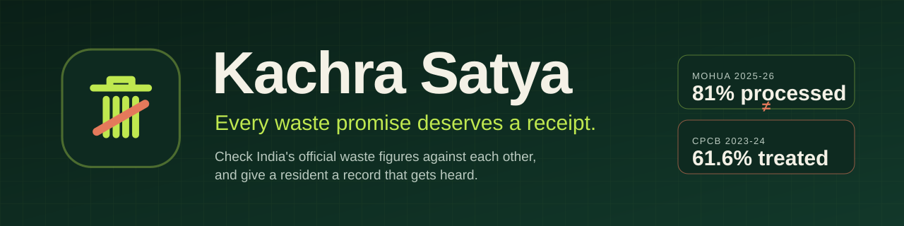

<p align="center">
  <a href="https://kachra-satya.onrender.com"></a>
</p>

<p align="center">
  <a href="https://kachra-satya.onrender.com"></a>
  
  <a href="https://youtu.be/kuiXp7VfZz8"></a>
</p>

<p align="center">
  
  
  
  
  
  
  
  
  <a href="LICENSE"></a>
</p>

<p align="center">
  <a href="https://kachra-satya.onrender.com"><b>Live site</b></a> &middot;
  <a href="https://youtu.be/kuiXp7VfZz8"><b>Demo video</b></a> &middot;
  <a href="#what-it-does">What it does</a> &middot;
  <a href="#join-your-profile-and-the-team-dashboard">Join and profile</a> &middot;
  <a href="#run-it">Run it</a> &middot;
  <a href="#how-we-know-it-is-right">How we know it is right</a> &middot;
  <a href="#limits-and-honesty">Limits</a> &middot;
  <a href="docs/features.md">Features</a>
</p>

---

# Kachra Satya

**Every waste promise deserves a receipt.**

Kachra Satya does two jobs. It helps a resident whose garbage is not collected keep a record and get heard. And it lets anyone check an official waste figure against the other official figures, on the page each one was printed on.

Built for the **Code for a Billion** hackathon, **Waste Management** track (submissions close 15 Nov 2026). Live at https://kachra-satya.onrender.com. **Demo video: https://youtu.be/kuiXp7VfZz8**

### At a glance
| | |
|---|---|
| **Data** | 676 rows, 36 states and UTs, 2019-20 to 2025-26, each row with its source document, page and retrieval date |
| **Receipts** | 696 of 706 figures open on the source page; for 605 the number itself is boxed |
| **Checks** | 72 flags from six consistency rules; 191 automated tests |
| **Languages** | English, Hindi, Telugu across the whole site; Tamil in Ask and the bin guide |
| **Ways in** | *The numbers* (check a figure) and *My street* (garbage not collected), switched on Home |
| **People** | About 35 people have tried it, by the team's count, including on phones |
| **Privacy** | The ward store keeps an anonymous code, never a name or email. The optional Join list is separate and consent-based |

*Kachra satya* means "the truth about garbage".

## Why it exists
India's Housing Ministry (MoHUA) and the pollution control board (CPCB) publish different numbers for the same municipal solid waste, and nothing checks them against each other.

| | Figure | Source |
|---|---|---|
| Housing Ministry (MoHUA) | 81% processed: 131,530 of 162,372 tonnes per day, 2025-26 | Rajya Sabha Q2433 (MoHUA answer, p.3) |
| CPCB | 61.6% treated: 114,110 of 185,195 tonnes per day, 2023-24 | Lok Sabha Q50, 1 Dec 2025 |
| Difference between the two national totals (a difference between reports, not missing waste) | 17,420 tonnes per day | MoHUA 2025-26 against CPCB 2023-24 |

These are different years, and CPCB says "treated" where MoHUA says "processed". We do not know that the two words mean the same thing ([data/definition_crosswalk.csv](data/definition_crosswalk.csv)), so we never say which figure is right.

Meanwhile a resident whose truck does not come has nothing to show for it. A phone call to the ward office is one person's word against the office's.

## Who it helps
| Person | What they could not do before | What Kachra Satya gives them |
|---|---|---|
| **A resident whose garbage is not picked up** | Prove the truck did not come | A dated record of each day, a complaint written for them, and a one-page **case file** that sets their record beside the state's official collection figure |
| **A group of neighbours** | Be counted together | A **shared total** for their ward: how many people reported, and how many reports said the truck came or did not. A QR code on a bin lets a neighbour join without installing anything |
| **Someone about to repeat a number** | Tell whether "81% processed" is the whole story | The other official figures for the same thing, the page each is printed on, and a **receipt** they can forward |
| **An MP, MLA, councillor or reporter** | Get a state's figures in plain words | A state card and a one-page briefing with sourced questions |
| **A school** | Run a waste project with a result | A one-week weighing challenge that ends in a report card |

It does not collect garbage. It helps a person be heard; whether the municipality acts is outside the app. About 35 people have tried it so far.

## The idea in one loop
Every page is one stop on the same loop, and each page says which one.

| Stop | A person asks | Pages |
|---|---|---|
| **1. Promise** | What did they say? | Check a claim, Ask |
| **2. Proof** | Is it true on paper? | Map, Insights, About |
| **3. Reality** | Is it true on my street? | Your ward, Your city |
| **4. Action** | What can I do about it? | Get help, Briefing, Schools, Nearest drop-off |

Home shows the loop, every other page carries a step bar with a link to the next stop, and the walk-through film labels each step. The definition is in `web/app/loop.js`; the thinking is in [docs/central_idea.md](docs/central_idea.md).

## Two ways in
A switch at the top of Home, remembered on the device.

- **The numbers** (the default): the map of India coloured by the gap, the lead case and the two official figures come first.
- **My street**: the headline is about uncollected garbage, the hero lists what to do today, and the menu leads with Your ward and Get help.

The switch changes order only. Every page stays in the menu in both modes, and a link or QR code opens the same page for everyone.

## What the app does
| Page | Route | What it gives you |
|---|---|---|
| **Home** | `#/start` | The switch above, four doors by visitor (garbage not collected, a quoted number, a briefing, a school), the map of India as the hero, one **lead case** chosen by rule (the state where the two newest figures are furthest apart: today Chandigarh, 100% and 22.5%), the loop, and a short self-playing walk-through that can be paused |
| **Check a claim** | `#/claim` | Type a sentence such as "81% of India's urban waste is processed". You get the verdict, the headline figure from each source, what it means and the evidence. Each result is a **receipt**: a link that reopens the check (`#/claim/<sentence>`, checked again on open), text to copy, or WhatsApp. Never "true" or "false" when sources disagree |
| **Map** | `#/map` | 36 states and UTs coloured by MoHUA, CPCB, the gap, or priority dumpsites. Tap a state for both figures and the source page ([docs/map.md](docs/map.md)) |
| **Insights** | `#/gaps`, `#/explore` | Opens on **six plain questions**, each with one number: do the numbers agree, is the money used, what goes uncollected, what ends up dumped, is waste kept separate, what goes unreported. Each tab gives the short answer, one simple chart, then every row folded below. Four more tabs check the sources: where to look first, every source page, figures that jump, what the words mean |
| **Your ward** | `#/ward` | Tap whether the truck came and keep a 30-day calendar. Sign in to add your taps to the **ward's shared total**. Make the **case file**. Print a QR code for the ward. Green-ward badge ([docs/ward_reports.md](docs/ward_reports.md), [docs/sign_in.md](docs/sign_in.md)) |
| **Get help** | `#/help` | Complaint writer for the official Swachhata-MoHUA app, a dated log, an escalation letter that quotes your ward record, a which-bin guide under the 2026 rules, a bulk-generator check ([docs/saathi.md](docs/saathi.md)) |
| **Your city** | `#/city` | A fictional worked example, then upload ward-level data (read in the browser) and see which figures cannot all be true |
| **Ask** | `#/ask` | Questions in English, Hindi, Tamil or Telugu, answered from the data with sources. Needs the server |
| **Briefing** | `#/brief` | A shareable plain-words card per state and a one-page briefing for an MP, MLA or councillor |
| **Schools** | `#/school` | Weigh a week of waste and get a report card |
| **Nearest drop-off** | `#/dropoff` | Where to take batteries, e-waste and recyclables (from OpenStreetMap, which is incomplete) |
| **Join** | `#/join` | One page to sign in with Google and give a few details, so the team can count its users and write back. Optional. Afterwards the header button shows your name and opens **My details** |
| **My details** | `#/me` | A signed-in person sees and edits what they gave on Join, signs out, or deletes it |
| **About** | `#/about` | How we check, the numbers behind the site, what we will not do, where the figures come from, the licence |

Home, Check a claim and Your ward each have a **"Take a 1-minute tour"** button: a box around one part of the page with a short numbered note (seven steps on Your ward, the busiest page). It only starts when pressed.

Features explained one by one: [docs/features.md](docs/features.md).

### Join, your profile and the team dashboard
The header has one button. Signed out it says **Join**; it opens a page with a Google button at the top, an "or", and a short form (name, email, role, state, city or ward, language, how you heard about us, and a consent box). When it is submitted the person lands on Home and the header button shows their first name instead of Join; pressing it opens **My details**, where they can change their details, sign out or delete them.

| | |
|---|---|
| **With Google** | The server checks Google's token and keeps the email Google vouches for, so the email cannot be faked. Signing in again later finds the same entry |
| **By hand** | Works too, but the entry can be edited only after the person signs in with the same Google email |
| **Consent** | A required tick box says what is kept and why. Nothing is sent until Join is pressed |
| **Kept apart** | The Join list holds contact details; the ward store holds none. The two are never joined, and deleting your details leaves your ward taps alone |
| **Spam guards** | A hidden trap field and a per-connection limit (`SIGNUPS_PER_HOUR`, default 6) |
| **Team dashboard** | `#/team`, behind an admin key typed in (never stored in the browser): how many joined and signed in, by role, state and language, the latest sign-ups, and a CSV download. Formulas typed into a name are neutralised in the CSV |

More detail, endpoints, settings and limits: [docs/join_and_dashboard.md](docs/join_and_dashboard.md).

### Ask answers in your language
The language chosen on the Ask page is sent to the AI model, so an answer to a Hindi, Tamil or Telugu question can come back in that language whatever language the question was typed in. Numbers, state and city names and document titles are kept exactly as they are in the data.

### The ward case file
One page written from what a resident already has: what happened (their truck record, with the missed dates), who else says so (the ward's shared total), what was done (complaints in their log), what the official figures say (with document and page), and what is asked. It can be copied, sent on WhatsApp or printed. A part with no data says so. The site writes it and never sends it.

### Sign-in and the shared ward total
Off unless the server is given a Google client ID and a database. A resident who signs in adds their taps to a total everyone sees for that ward. The server stores an anonymous code, the ward, the day and the answer, and **no name or email**. Nothing is sent, and Google's script is not loaded, until the person presses "Turn on sharing". They can sign out or delete everything they shared. The team has used real Google sign-in on the live site, against the Neon database. Set-up and limits: [docs/sign_in.md](docs/sign_in.md).

### Languages
English, Hindi and Telugu, switched in the header. The whole site changes: menus, headings, buttons, notes and forms. Figures, state names, document names, anything a person types and the drafted letters are never translated. Pages measure 71% to 100% translated in the browser; the rest is text that comes straight from the data files. The translations are in `web/app/i18n/*.txt` and were read through by two team members on 2026-11-15, one per language: the Hindi by Yasaswini and the Telugu by Sriya, who found them good. That is a read by teammates, not an independent or professional review. The Tamil in the bin guide and in Ask answers has since been reviewed by the team as well.

### Design
The "Eco-Intelligence Observatory" system, light and dark ([docs/ui_theme.md](docs/ui_theme.md)). Fonts are self-hosted under the SIL Open Font License: Anek for text in Latin, Devanagari and Telugu, Teko for big figures, Martian Mono for small data labels. The icon is a bin whose ribs are tally marks, one for each count that has to add up (`web/app/icon.svg`).

## The data
- **676 rows** for 36 states and UTs, in tonnes per day, 2019-20 to 2025-26; 666 carry a reported value. Every row names its source document, page and retrieval date. Missing values stay blank and say "not reported"; nothing is estimated or filled in.
- **72 flags** from six consistency rules. Examples: Kerala reports more waste treated than collected in four years; MoHUA and CPCB differ by more than 10% for 53 state-and-metric pairs.
- **Receipts:** 696 of 706 figures open on a source page, and for 605 the number itself is boxed on the page.
- **Dumpsites:** the 214 priority legacy dumpsites in MoHUA's list. Its tables itemise 189; Maharashtra and Bihar are printed as "Reserved" with no rows.
- Supporting tables: funds, MoHUA statements, definition crosswalk, audit priority, recurrence, phantom tonnes, money vs mess, volatility, state indicators, truck priority, segregation, completeness. Column meanings: [docs/data_dictionary.md](docs/data_dictionary.md).
- Every document is listed with publisher, URL and retrieval date in [SOURCES.md](SOURCES.md).

## Run it
Needs Python 3.12 (pandas, pdfplumber, python-docx). Node is optional, for the tests that run the browser code.

```bash
python -m http.server 8777
```
Then open http://127.0.0.1:8777/web/app/index.html.

**The server (optional).** `agent/` is a Flask server that answers Ask and holds sign-in and the shared ward totals. A static copy works without it: Ask says "not connected yet" and ward taps stay on the device. To run it locally, follow [agent/README.md](agent/README.md), then:
```bash
ALLOWED_ORIGINS=http://127.0.0.1:8777 python agent/app.py
```
On a local address the page finds the server at `http://127.0.0.1:5000` by itself. Without `MODEL_API_KEY` Ask answers in a fallback mode from the data. Do not commit a key.

**Environment variables for the server**

| Variable | What it does |
|---|---|
| `MODEL_PROVIDER`, `MODEL_API_KEY` | `gemini`, `anthropic` or `grok`, and its key. Empty key: Ask answers from the data only |
| `GEMINI_MODEL`, `GEMINI_FALLBACK_MODEL` | The Gemini model, and an optional second one tried once when the first is overloaded, over quota or times out. `/health` shows the model in use and the last model error |
| `ALLOWED_ORIGINS` | Sites allowed to call the server when it does not serve the site itself |
| `GOOGLE_CLIENT_ID` | Switches sign-in on (with `KS_SECRET`). Empty: sign-in is off and nothing is stored |
| `KS_SECRET` | Signs sessions and salts the anonymous codes |
| `DATABASE_URL` | PostgreSQL (the live site uses Neon) for the ward totals and the Join list. Empty: a local SQLite file, which a free host wipes on every deploy |
| `KS_ADMIN_KEY` | Opens the team dashboard and the sign-up CSV. Case-sensitive. Empty: both return "not found". Set it only in the host's environment, never in the repo |
| `SIGNUPS_PER_HOUR` | Join sign-ups allowed per connection per hour (default 6) |

**Server endpoints**

| Endpoint | Who can call it | What it does |
|---|---|---|
| `POST /ask` | anyone | Answer a question from the data, in the chosen language |
| `GET /health` | anyone | Status, the model in use and the last model error |
| `GET /api/config` | anyone | Whether sign-in is on, and the Google client id |
| `POST /api/signin` | anyone with a Google token | Returns a session token; links an existing Join entry with the same verified email |
| `POST /api/ward/report`, `GET /api/ward/summary` | signed-in / anyone | Add a tap; public counts for a ward |
| `POST /api/signup`, `GET /api/signup/count` | anyone | Join; the public number of people who joined |
| `GET`, `PUT`, `DELETE /api/me/profile` | signed-in person, own entry only | See, edit or delete the Join details |
| `DELETE /api/me` | signed-in person | Delete everything this person shared |
| `GET /api/signups` | `X-Admin-Key` header | CSV of the Join list, or `?format=json` for the dashboard numbers |

**Live site.** https://kachra-satya.onrender.com runs the whole project as one Render web service: the Flask server serves the built site and answers Ask (`render.yaml`, [docs/deploy.md](docs/deploy.md)). It is on a free plan, so the first visit after a quiet spell can take about a minute; `/health` wakes it.

**Static build.** `python scripts/build_site.py` writes `dist/` (the web app and receipts only; no source documents or CSVs).

**Translations.** After editing `web/app/i18n/*.txt`, run `python scripts/build_i18n.py` and commit `web/app/i18n_dict.js`. A test fails if it is stale.

### Rebuild from the source documents in `data/raw/`
```bash
python scripts/build_clean_csv.py
python scripts/add_cpcb_2021_22_landfilled.py
python scripts/add_cpcb_2022_23.py
python scripts/extract_funds.py
python scripts/extract_au3198.py
python scripts/extract_drap.py
python scripts/build_dumpsite_national.py
python scripts/validate.py
python scripts/volatility.py
python scripts/recurrence_and_priority.py
python scripts/phantom_tonnes.py
python scripts/state_indicators.py
python scripts/completeness.py
python scripts/make_receipts.py
python scripts/export_web_data.py
python scripts/build_india_map.py
python -m pytest -q tests
```

## How we know it is right
- Each state column sums to the table's printed total (differences under 0.6 tpd are source rounding; one 2 tpd gap in MoHUA 2025-26 is in the source itself).
- 664 of 666 numeric cells were found on their cited PDF page; the other 2 are "Nil" cells stored as 0.
- CPCB 2021-22 Table 1 agrees exactly with Rajya Sabha Q358, an independent cross-check.
- A 30-cell visual spot check matched 30 of 30, but it was AI-assisted, not a manual hand check. A human check is set up (`web/trust/spotcheck.html`, scored by `scripts/score_human_spot_check.py`) and has **not** been recorded yet.
- **191 automated tests pass** (`python -m pytest -q tests`). Among other things they check that:
  - the browser claim checker gives the same verdicts as the Python one;
  - the numbers on Home and Insights match the CSVs, and the lead case is the one the rule picks;
  - the case file never invents a part that has no data;
  - the ward store holds no name, email or Google account id, and the Join list is private, rate-limited and consent-based;
  - a signed-in person can reach only their own Join entry, and the email cannot be changed;
  - Ask sends the chosen language to the model;
  - Hindi and Telugu cover the same text, and the built dictionary is current;
  - every browser script parses.

  They test extraction, consistency and behaviour, not whether a source is correct.

Details: [docs/methodology.md](docs/methodology.md), [docs/validation_summary.md](docs/validation_summary.md).

## Limits and honesty
- **Truth.** All figures are self-reported by states, cities and boards. We check extraction and consistency, not correctness.
- **Definitions.** Storing MoHUA "processed" as CPCB-style "treated" is our assumption.
- **Resident reports are unverified.** A ward total is a count of reports from signed-in residents, not a measurement. One person with two Google accounts counts twice. Ward names are free text, so two spellings are two wards.
- **Sign-in at scale is untested.** It has been used for real (Google and Neon PostgreSQL) by a small number of people; many at once has not been tried.
- **The Join list is personal data.** It holds names and emails given with consent. It is behind an admin key, never shown to anyone, and deletable by the person who gave it; keep the key private and change it after the hackathon.
- **Coverage.** Segregation, collection routing, recycling markets and plastic tracking are partly covered or not covered ([docs/track_coverage.md](docs/track_coverage.md)). No route optimisation, no recycling price data.
- **State landfilled** is reported only for 2021-22 and 2022-23. The funds table (Lok Sabha Q682) prints no unit, so only ratios are used.
- **Dumpsites.** The documents name cities, not sites, and give no coordinates.
- **Map.** The state boundaries have not been checked against the Survey of India official map.
- **Drafts only.** The complaint, log, letters and case file are text for the user to send. The app sends nothing.
- **Rules.** Four waste streams and bulk-generator thresholds come from the SWM Rules 2026 PIB release of 28 Jan 2026; the Gazette notification itself has not been read.

## Data, sources and attribution
- `data/raw/` and `receipts/pages/` are unchanged copies of published government documents, kept so a figure can be checked against its page. Rights stay with each publisher ([data/raw/NOTICE.md](data/raw/NOTICE.md), [receipts/NOTICE.md](receipts/NOTICE.md)). We are not affiliated with or endorsed by the Lok Sabha or Rajya Sabha Secretariat, CPCB or MoHUA.
- The team decided to use these public records with attribution and a remove-on-request promise. No permission request has been sent, and reuse terms were not confirmed with the publishers ([docs/licences.md](docs/licences.md)).
- Code and our compiled data are MIT ([LICENSE](LICENSE)). That covers our compilation, checks and derived tables, not the source documents. Citation: [CITATION.cff](CITATION.cff).
- Fonts: SIL Open Font License ([web/app/fonts/OFL.txt](web/app/fonts/OFL.txt)). Drop-off points: OpenStreetMap contributors, ODbL.

## Repository map
| Folder | What is in it |
|---|---|
| `data/` | The CSVs; `data/raw/` holds the source documents |
| `scripts/` | Extraction, validation, analysis, map, site build, translation build and release scripts |
| `web/app/` | The app: routes, Home, map, Insights, Get help, ward, case file, sign-in, languages, theme, fonts |
| `web/app/i18n/` | Hindi and Telugu translations as plain text |
| `web/trust/` | The inlined data (`data.js`) and the claim checker |
| `agent/` | The Flask server: Ask (`app.py`), and sign-in, the shared ward store, Join and the team list (`accounts.py`) |
| `receipts/` | Source page images and the index placing each figure on its page |
| `briefs/` | One-page Action Briefs per state |
| `docs/` | The banner (`assets/`), methodology, features, sign-in, licences, track coverage, UI, deploy, demo script, submission checklist, user tests |
| `tests/` | The 191 automated tests |

## Reply or report an error
A state, city or department can reply to a figure, and anyone can report a mismatch with its source page, through the issue forms in `.github/ISSUE_TEMPLATE/`. We show replies beside the figure, never delete a published figure, and fix and log our own mistakes.

## Team
- **Yasaswini (Yasaswini-ch):** trust layer (claim checker, receipts, audit list, definitions), data publishing, Home page and guided paths.
- **Sriya Meenakshi Chalamalasetty:** data sourcing and extraction, money and gaps, Your ward pages, user tests.
- **Likhitha:** platform and design system, Q&A agent setup, deployment, demo and submission.
